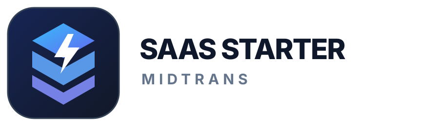

<!-- Logo proyek -->
<div align="center">



### Starter kit SaaS modern dengan Next.js, Supabase, PostgreSQL, dan Midtrans.

<p>
  <a href="https://saas-starter-midtrans.vercel.app/"><strong>🌐 Lihat Demo</strong></a>
  &nbsp;·&nbsp;
  <a href="https://github.com/Bagaas-ind/Saas-starter-midtrans/issues">🐛 Laporkan Bug</a>
  &nbsp;·&nbsp;
  <a href="https://github.com/Bagaas-ind/Saas-starter-midtrans/pulls">🤝 Kontribusi</a>
</p>

<p>
  
  
  
  
  
  
  
</p>

<p>
  
  
  
</p>

**Bahasa:** 🇮🇩 Indonesia · [🇬🇧 English](README.en.md)

</div>

---

## 📌 Tentang Proyek

**SaaS Starter — Midtrans** adalah starter kit untuk developer yang ingin membangun aplikasi berbasis SaaS atau langganan. Proyek ini menggabungkan autentikasi pengguna, dashboard terlindungi, contoh paket langganan, dan alur checkout pembayaran menggunakan Midtrans Snap.

Gunakan proyek ini sebagai fondasi awal, lalu sesuaikan fitur dan tampilannya dengan kebutuhan produk SaaS yang ingin kamu bangun.

## 📍 Status Proyek

Proyek ini dikembangkan sebagai starter kit open-source dan masih terus disempurnakan. Fitur pembayaran saat ini menggunakan lingkungan **Midtrans Sandbox** untuk kebutuhan pengembangan dan pengujian. Demo publik disediakan untuk melihat tampilan serta alur antarmuka aplikasi.

## 🧰 Teknologi yang Digunakan

<div align="center">
  <a href="https://skillicons.dev">
    
  </a>
</div>

| Teknologi | Kegunaan |
| --- | --- |
| Next.js 15 | Framework React dan App Router |
| React 19 | Membangun antarmuka pengguna |
| TypeScript | Menulis kode dengan sistem tipe |
| Tailwind CSS | Styling antarmuka |
| Supabase Auth | Autentikasi pengguna |
| Supabase PostgreSQL | Database dan Row Level Security |
| Midtrans Snap | Checkout pembayaran |
| Zod | Validasi konfigurasi environment |

## ✨ Fitur

- 🔐 **Autentikasi** — registrasi dan login menggunakan Supabase Auth.
- 📊 **Dashboard terlindungi** — halaman dashboard hanya untuk pengguna yang sudah login.
- 💳 **Checkout pembayaran** — pembuatan transaksi melalui Midtrans Snap.
- 📦 **Contoh paket langganan** — data paket Free, Pro, dan Enterprise.
- 🧾 **Riwayat transaksi** — menampilkan riwayat pembayaran dasar di dashboard.
- 🛡️ **Keamanan database** — Row Level Security dan trigger untuk mencegah pengguna mengubah plan tier miliknya sendiri.
- ⚙️ **Validasi konfigurasi** — environment variable divalidasi menggunakan Zod.
- 🔄 **Continuous Integration** — GitHub Actions menjalankan pemeriksaan TypeScript dan production build.

### Fitur yang belum tersedia

Proyek ini belum menjadi platform langganan lengkap. Penagihan otomatis berulang, invoice, manajemen tim, pencatatan penggunaan, dan siklus langganan secara menyeluruh masih perlu dikembangkan.

Penguatan keamanan pembayaran berikut juga masih dalam tahap implementasi dan verifikasi:

- **Atomic fulfillment** melalui PostgreSQL RPC sudah disiapkan, tetapi perlu diterapkan pada database dan diuji pada lingkungan Supabase proyek.
- **Perlindungan notifikasi bersamaan** menggunakan conditional update dan row-level locking di database masih perlu diverifikasi melalui pengujian konkurensi.
- **Validasi currency** pada webhook sudah ditambahkan untuk mata uang IDR, tetapi tetap perlu diuji dengan payload notifikasi Sandbox yang valid dan tidak valid.

---

## 🚀 Cara Menjalankan Proyek

### Persyaratan

Pastikan perangkatmu sudah memiliki:

- [Node.js versi 22 atau lebih baru](https://nodejs.org/)
- npm
- Git
- Akun dan project [Supabase](https://supabase.com/)

### 1. Clone repository

Jalankan perintah berikut di terminal:

```bash
git clone https://github.com/Bagaas-ind/Saas-starter-midtrans.git
cd Saas-starter-midtrans
npm ci
```

### 2. Atur environment variable

Buat file `.env.local` dari file contoh.

**Windows PowerShell**
```powershell
Copy-Item .env.example .env.local
```

**Windows CMD**
```cmd
copy .env.example .env.local
```

**macOS / Linux**
```bash
cp .env.example .env.local
```

Buka file `.env.local`, lalu isi dengan kredensial milikmu:

```env
NEXT_PUBLIC_SUPABASE_URL=https://YOUR_PROJECT_ID.supabase.co
NEXT_PUBLIC_SUPABASE_ANON_KEY=YOUR_SUPABASE_ANON_KEY
SUPABASE_SERVICE_ROLE_KEY=YOUR_SUPABASE_SERVICE_ROLE_KEY

MIDTRANS_SERVER_KEY=SB-Mid-server-YOUR_SANDBOX_SERVER_KEY
NEXT_PUBLIC_MIDTRANS_CLIENT_KEY=SB-Mid-client-YOUR_SANDBOX_CLIENT_KEY
MIDTRANS_IS_PRODUCTION=false

NEXT_PUBLIC_APP_URL=http://localhost:3000
```

> 🔒 Jangan pernah mengunggah file `.env.local` ke GitHub. Jaga kerahasiaan `SUPABASE_SERVICE_ROLE_KEY` dan `MIDTRANS_SERVER_KEY`.

### 3. Siapkan database Supabase

1. Buat project baru di Supabase.
2. Buka menu **SQL Editor** pada dashboard Supabase.
3. Buka file `supabase/schema.sql` dari repository ini.
4. Salin seluruh isi file SQL tersebut ke SQL Editor.
5. Jalankan query dan pastikan tabel `plans`, `profiles`, dan `transactions` berhasil dibuat.

Schema tersebut juga mengatur trigger pembuatan profil saat registrasi, data paket awal, dan kebijakan Row Level Security.

### 4. Atur URL autentikasi

Buka **Supabase → Authentication → URL Configuration**:

- Atur Site URL menjadi `http://localhost:3000`.
- Tambahkan `http://localhost:3000/auth/callback` ke daftar Allowed Redirect URLs.

### 5. Jalankan aplikasi

```bash
npm run dev
```

Buka browser dan akses **http://localhost:3000**.

---

## 🧪 Mencoba Aplikasi

Setelah aplikasi berjalan:

1. Buka halaman utama.
2. Daftarkan akun menggunakan email yang dapat kamu akses.
3. Lakukan konfirmasi email jika fitur tersebut diaktifkan di Supabase.
4. Login dan buka dashboard.
5. Pastikan akun baru menggunakan paket Free.
6. Atur Midtrans Sandbox sebelum mencoba paket berbayar.

Jika profil tidak terbentuk setelah registrasi, periksa data pengguna di Supabase Auth, trigger database, dan log Supabase.

## 💸 Pengujian Pembayaran Midtrans Sandbox

**Gunakan kredensial Sandbox saja. Jangan gunakan data pembayaran pelanggan sungguhan.**

1. Buka dashboard Midtrans dan pilih lingkungan **Sandbox**.
2. Salin Sandbox Server Key dan Client Key ke file `.env.local`.
3. Pastikan `MIDTRANS_IS_PRODUCTION=false`.
4. Atur URL notifikasi menjadi `https://YOUR_PUBLIC_HOST/api/payment/webhook`.
5. Untuk pengujian lokal, gunakan HTTPS tunnel agar Midtrans dapat mengakses aplikasi. Midtrans tidak dapat mengirim notifikasi ke alamat `localhost`.
6. Restart server, login, lalu pilih paket berbayar.
7. Selesaikan checkout menggunakan data pengujian dari Midtrans Sandbox Simulator.
8. Periksa status transaksi melalui dashboard.

### Alur pembayaran

```text
┌────────────────────────┐
│ Pengguna memilih paket │
└───────────┬────────────┘
            ▼
┌─────────────────────────────┐
│ POST /api/payment/create    │
│ Validasi pengguna dan paket │
│ Buat transaksi Snap         │
│ Simpan transaksi pending    │
└───────────┬─────────────────┘
            ▼
┌─────────────────────────────┐
│     Midtrans Snap Checkout  │
└───────────┬─────────────────┘
            ▼
┌─────────────────────────────┐
│ POST /api/payment/webhook   │
│ Verifikasi notifikasi       │
│ Perbarui status transaksi   │
└───────────┬─────────────────┘
            ▼
┌─────────────────────────────┐
│ Supabase → Dashboard User   │
└─────────────────────────────┘
```

Redirect browser bukan bukti bahwa pembayaran berhasil. Status transaksi diperbarui melalui notifikasi server Midtrans. Sebelum digunakan di produksi, proses webhook masih perlu penguatan validasi nominal dan pemrosesan yang aman terhadap notifikasi ganda atau bersamaan.

---

## 📁 Struktur Folder

```text
.
├── .github/
│   └── workflows/       # Workflow CI
├── docs/
│   └── assets/          # Logo proyek
├── src/
│   ├── app/
│   │   ├── api/payment/ # Endpoint pembayaran dan webhook
│   │   ├── auth/        # Callback autentikasi
│   │   └── dashboard/   # Dashboard pengguna
│   ├── components/      # Komponen UI
│   ├── lib/
│   │   ├── supabase/    # Supabase client
│   │   ├── env.ts       # Validasi environment
│   │   └── midtrans.ts  # Integrasi Midtrans
│   ├── middleware.ts
│   └── types/
├── supabase/
│   └── schema.sql       # Schema dan kebijakan database
├── .env.example
├── CONTRIBUTING.md
├── SECURITY.md
└── package.json
```

## 🛠️ Perintah yang Tersedia

| Perintah | Kegunaan |
| --- | --- |
| `npm ci` | Menginstal dependency |
| `npm run dev` | Menjalankan development server |
| `npx tsc --noEmit` | Memeriksa tipe TypeScript |
| `npm run lint` | Menjalankan perintah lint |
| `npm run build` | Membuat production build |
| `npm run start` | Menjalankan production build secara lokal |

Sebelum membuat Pull Request, jalankan:

```bash
npx tsc --noEmit
npm run build
```

## 🔐 Checklist Sebelum Produksi

Jangan gunakan starter kit ini untuk menangani pembayaran sungguhan sebelum pekerjaan keamanan dan pembayaran berikut diselesaikan.

- [x] Mencegah pengguna mengubah `plan_tier` miliknya melalui akses database dari sisi klien.
- [ ] Validasi nominal, mata uang, order ID, status, dan harga paket pada webhook.
- [ ] Pastikan pemrosesan webhook aman terhadap notifikasi duplikat dan proses bersamaan.
- [ ] Tinjau seluruh transisi status pembayaran dan fraud dari Midtrans.
- [ ] Tambahkan rate limiting, batas ukuran request, dan penanganan error.
- [ ] Tinjau permission database, kebijakan RLS, dan operasi server dengan hak istimewa.
- [ ] Tambahkan unit test, integration test, dan webhook test.
- [ ] Tambahkan monitoring, alerting, backup, dan prosedur rotasi kredensial.
- [ ] Verifikasi HTTPS, callback URL, privasi, dan kewajiban hukum yang berlaku.

Baca [SECURITY.md](SECURITY.md) untuk mengetahui proses pelaporan kerentanan keamanan.

## 🤝 Kontribusi

Kontribusi sangat terbuka, baik berupa perbaikan bug, penambahan pengujian, dokumentasi, peningkatan aksesibilitas, maupun fitur yang bermanfaat.

1. Buat branch baru untuk perubahanmu.
2. Kerjakan satu peningkatan yang jelas dan terfokus.
3. Jalankan pemeriksaan yang telah disebutkan di atas.
4. Buat Pull Request dengan penjelasan perubahan dan hasil pengujian.

Silakan baca [CONTRIBUTING.md](CONTRIBUTING.md) sebelum berkontribusi.

## 📄 Lisensi

Proyek ini menggunakan [MIT License](LICENSE).

---

<div align="center">

**Mulai dari fondasi ini, lalu bangun produk SaaS milikmu sendiri.** ⚡

<sub>Disediakan apa adanya tanpa jaminan. Pastikan aplikasi ditinjau, diamankan, dan diuji sebelum digunakan dengan pelanggan sungguhan.</sub>

</div>
